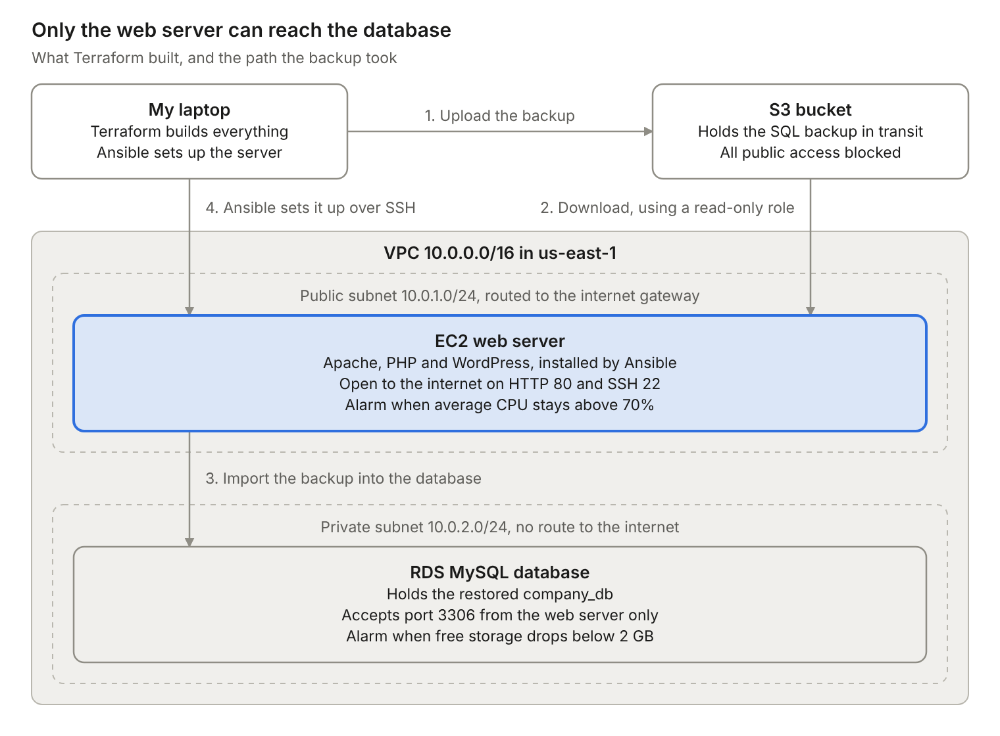
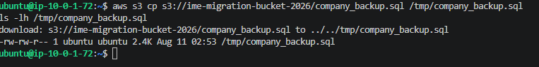
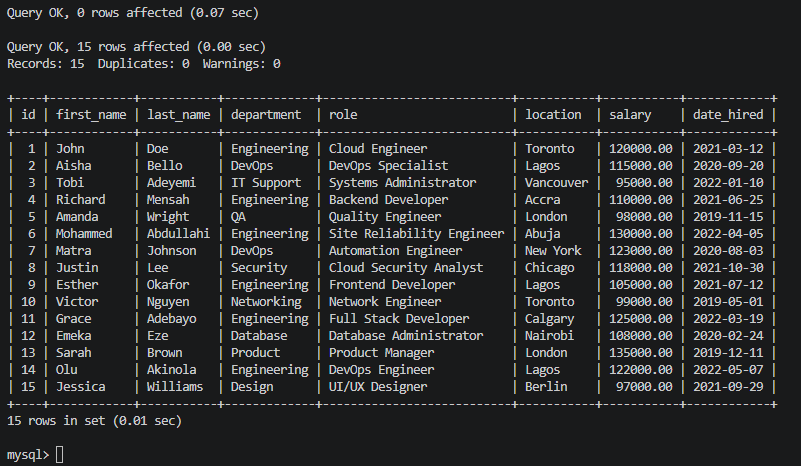
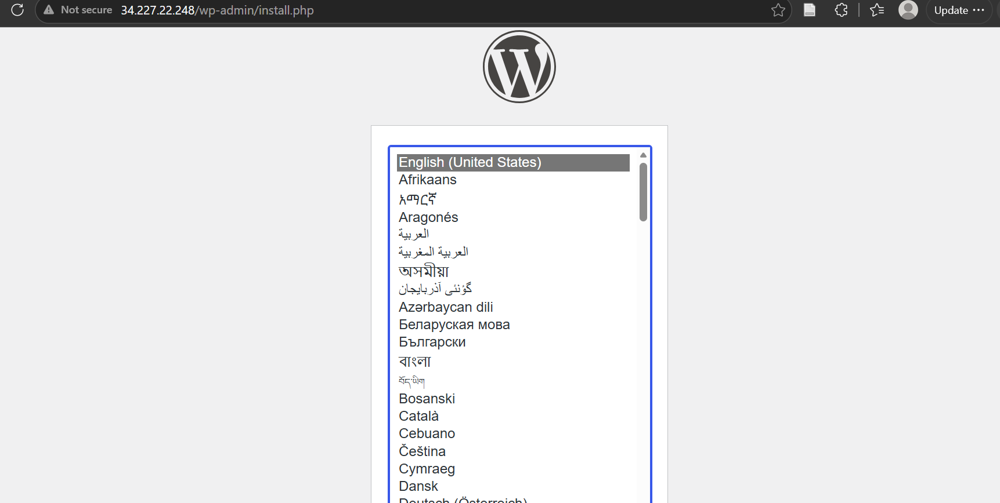

# WordPress to AWS: a migration with Terraform, RDS and Ansible

This project moves a legacy WordPress site and its MySQL database onto AWS. Terraform builds the environment, S3 and EC2 carry the database backup into Amazon RDS, and Ansible turns a bare Ubuntu server into a WordPress server.

It is a practice migration that I built and ran in my own AWS account to learn how real ones work.



## What it builds

- **Network:** a VPC (`10.0.0.0/16`) with a public subnet for the web server and a private subnet for the database, an internet gateway and a route table.
- **Firewall rules:** the web server accepts SSH (22) and HTTP (80). The database accepts MySQL (3306) from the web server's security group only.
- **Storage:** an S3 bucket for the database backup, with all public access blocked.
- **Permissions:** an IAM role that gives the web server read-only access to S3, so no AWS keys sit on the server.
- **Compute:** a `t2.micro` EC2 instance in the public subnet.
- **Database:** a MySQL 8.0 instance on Amazon RDS, not publicly accessible.
- **Monitoring:** two CloudWatch alarms, one for EC2 CPU above 70% and one for RDS free storage below 2 GB.

## Repository layout

```
.
├── terraform/
│   ├── provider.tf                # AWS provider and region
│   ├── variables.tf               # the settings the code expects
│   ├── terraform.tfvars.example   # copy to terraform.tfvars and fill in
│   ├── networking.tf              # VPC, subnets, internet gateway, routes
│   ├── security.tf                # security groups
│   ├── s3.tf                      # backup bucket
│   ├── iam.tf                     # read-only S3 role for the server
│   ├── ec2.tf                     # web server
│   ├── rds.tf                     # MySQL database
│   ├── cloudwatch.tf              # alarms
│   └── outputs.tf                 # server IP and database address
├── ansible/
│   ├── inventory.ini.example      # copy to inventory.ini and fill in
│   ├── playbook.yml               # installs Apache, PHP and WordPress
│   └── wp-config.php.j2           # WordPress config template
├── database/
│   └── company_backup.sql         # simulated company database (sample data)
└── docs/images/
```

## How to run it

You need an AWS account, the AWS CLI, Terraform and Ansible. I used Terraform 1.14 and AWS CLI 2.33 on Windows, with Ansible running in WSL because it does not run natively on Windows.

### 1. Build the infrastructure

```bash
cd terraform
cp terraform.tfvars.example terraform.tfvars   # then edit the values
terraform init
terraform plan
terraform apply
terraform output                               # note ec2_public_ip and rds_endpoint
```

### 2. Move the database

The database only accepts connections from the web server, so the backup travels in three hops: laptop to S3, S3 to EC2, EC2 to RDS.

The backup in this repo, `database/company_backup.sql`, is simulated data: one `employees` table with 15 sample rows.

From your own machine, in the repository root:

```bash
aws s3 cp database/company_backup.sql s3://<your-bucket>/company_backup.sql
```

Then on the EC2 server, over SSH:

```bash
sudo apt install awscli mysql-client -y
aws s3 cp s3://<your-bucket>/company_backup.sql /tmp/company_backup.sql
ls -lh /tmp/company_backup.sql                 # check the size is not 0

mysql -h <rds-endpoint> -u admin -p
```

```sql
CREATE DATABASE company_db;
USE company_db;
SOURCE /tmp/company_backup.sql;
```





### 3. Configure the server

```bash
cd ansible
cp inventory.ini.example inventory.ini         # then edit the values
ansible -i inventory.ini wordpress -m ping     # should answer "pong"
ansible-playbook -i inventory.ini playbook.yml \
  -e db_password='<your-password>' -e rds_endpoint='<rds-endpoint>'
```

My run finished with `ok=6 changed=5 unreachable=0 failed=0`.

### 4. Finish the deployment

On the EC2 server:

```bash
sudo rm /var/www/html/index.html
sudo mv /var/www/html/wordpress/* /var/www/html/
sudo chown -R www-data:www-data /var/www/html/
sudo chmod -R 755 /var/www/html/
sudo systemctl restart apache2
```

Open `http://<ec2-public-ip>` in a browser. The WordPress setup page should load.



### 5. Clean up

```bash
cd terraform
terraform destroy
```

## What went wrong on the first run

- **A key pair that did not exist.** My settings named a key pair my AWS account does not have. AWS returned `InvalidKeyPair.NotFound`. The fix was one value in `terraform.tfvars`.
- **An error that pointed the wrong way.** The S3 bucket failed with `AuthorizationHeaderMalformed`, saying my region was wrong. The region was fine. The bucket name was already taken by another AWS account, because bucket names are unique across all of AWS.
- **An empty backup.** I uploaded the wrong file and every command still reported success. Only `ls -lh` on the server showed it was 0 bytes. I now check the file size at every hop.
- **A key SSH would not accept.** My project folder sits on a Windows drive, where Linux file permissions do not stick. The key has to live inside WSL's own filesystem, and the inventory needs its full path.

## What I would change for production

This is a learning build. Before calling it production I would fix these:

- **Secrets.** When I ran this, the database password sat in `terraform.tfvars` and in the playbook. In this repo both are placeholders. The next step is AWS Secrets Manager or Ansible Vault.
- **SSH open to the world.** Port 22 accepts any address. I would restrict it to my own IP or use AWS Systems Manager Session Manager.
- **The manual last step.** The five commands in step 4 belong in the playbook.
- **A fixed AMI ID.** `ec2.tf` names one image. A lookup for the current Ubuntu image would keep working across regions.
- **The database subnets.** RDS needs subnets in two Availability Zones, so its subnet group includes the public subnet. A second private subnet would be cleaner.
- **No HTTPS.** The site answers on plain HTTP.
- **Local state.** Terraform's state stayed on my laptop. A team needs it in shared remote storage with locking.

## Author

Ime-Jnr Ime-Essien · [LinkedIn](https://www.linkedin.com/in/ime-jnr-ime-essien-27897021a) · [GitHub](https://github.com/IMMZY)
